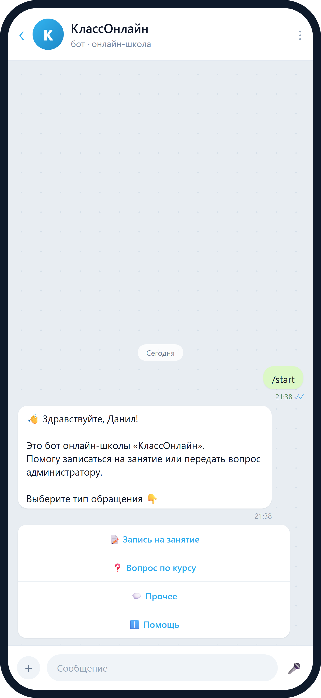
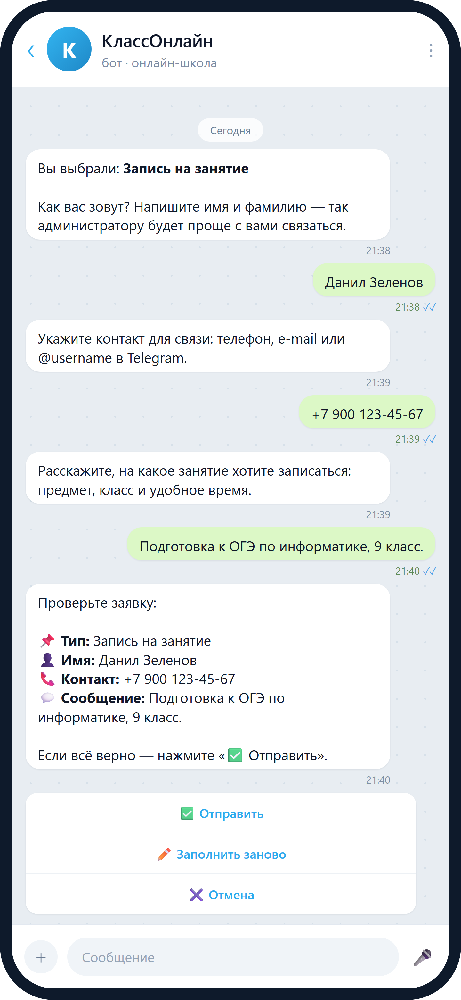
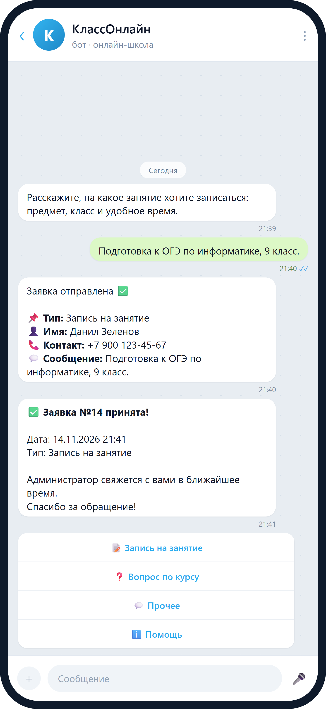
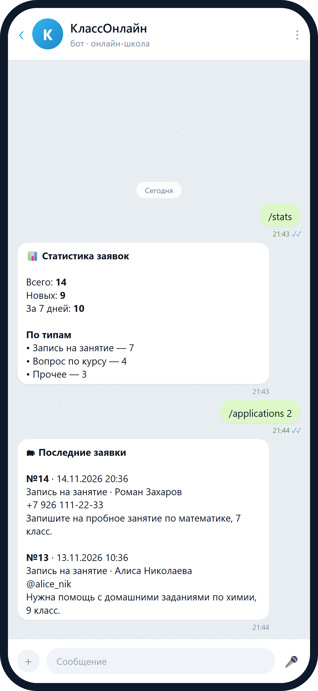

# Telegram-бот «КлассОнлайн»

Бот для онлайн-школы «КлассОнлайн»: принимает заявки на занятия, вопросы по курсам и прочие обращения, сохраняет их в SQLite и сразу уведомляет администратора.

**Производственная практика** · IT TOP college · ноябрь 2026

| | |
|---|---|
| **Выполнил** | Зеленов Данил Сергеевич |
| **Группа** | 11/3-РПО-24/1 |
| **Куратор** | Максим Николаевич |
| **Организация** | КлассОнлайн |
| **Репозиторий** | [github.com/Duke13337/classonline-bot](https://github.com/Duke13337/classonline-bot) |

<p align="center">
  
  
  
  
</p>

<p align="center"><i>Экраны бота на демонстрационных данных</i></p>

## Возможности

- **Три типа обращений:** запись на занятие, вопрос по курсу, прочее.
- **Пошаговый диалог:** имя → контакт → текст обращения → проверка → отправка.
- **Проверка ввода:** телефон, e-mail или `@username`; длина имени и сообщения.
- **SQLite:** заявка сохраняется автоматически и не теряется при перезапуске.
- **Уведомления:** новая заявка сразу приходит администратору в Telegram.
- **Админ-команды:** `/stats`, `/applications [N]`, `/export` (CSV для Excel).
- **Защита от HTML-инъекций:** пользовательский текст экранируется перед отправкой.
- **40 автотестов:** валидация, база данных, тексты и CSV-экспорт.

## Стек

| Технология | Версия | Роль |
|---|---|---|
| Python | 3.12 | язык разработки |
| aiogram | 3.31.0 | Telegram Bot API, FSM, роутеры |
| SQLite + aiosqlite | 3 / 0.22.1 | хранение заявок |
| python-dotenv | 1.2.4 | загрузка токена из `.env` |
| pytest | 9.2.0 | автотесты |
| Git + GitHub | — | версии и публикация |

## Быстрый старт

### 1. Клонирование и окружение

```bash
git clone https://github.com/Duke13337/classonline-bot.git
cd classonline-bot
```

**Windows (PowerShell):**

```powershell
python -m venv .venv
.venv\Scripts\activate
pip install -r requirements.txt
```

**Linux / macOS:**

```bash
python3 -m venv .venv
source .venv/bin/activate
pip install -r requirements.txt
```

### 2. Настройка

Скопируйте `.env.example` в `.env` и заполните значения:

```env
BOT_TOKEN=123456789:AAHxxxxxxxxxxxxxxxxxxxxxxxxxxxxxxxxx
ADMIN_IDS=123456789
DB_PATH=data/applications.db
```

| Переменная | Обязательна | Назначение |
|---|---|---|
| `BOT_TOKEN` | да | токен бота от [@BotFather](https://t.me/BotFather) |
| `ADMIN_IDS` | нет | Telegram ID администраторов через запятую |
| `DB_PATH` | нет | путь к базе, по умолчанию `data/applications.db` |

Узнать свой Telegram ID можно у [@userinfobot](https://t.me/userinfobot).

### 3. Запуск

```bash
python -m bot
```

или:

```bash
python run.py
```

В консоли появится путь к базе и список администраторов. Остановка — `Ctrl+C`.

## Команды бота

| Команда | Кому | Что делает |
|---|---|---|
| `/start` | всем | приветствие и главное меню |
| `/help` | всем | справка по работе бота |
| `/cancel` | всем | отменить заполнение заявки |
| `/stats` | админам | всего заявок, новых, за 7 дней, по типам |
| `/applications [N]` | админам | последние N заявок (по умолчанию 5, максимум 20) |
| `/export` | админам | CSV-файл со всеми заявками |

Доступ к админ-командам проверяется по `ADMIN_IDS`. Остальные пользователи получают вежливый отказ.

## Структура проекта

```text
classonline-bot/
├── bot/
│   ├── __main__.py        # запуск: python -m bot
│   ├── config.py          # настройки из .env
│   ├── database.py        # схема SQLite и репозиторий заявок
│   ├── models.py          # Application, ApplicationStats
│   ├── validation.py      # проверка имени, контакта и текста
│   ├── keyboards.py       # инлайн-клавиатуры
│   ├── states.py          # состояния FSM
│   ├── texts.py           # тексты и форматирование сообщений
│   ├── services.py        # экспорт в CSV
│   ├── main.py            # сборка Dispatcher и запуск polling
│   └── handlers/
│       ├── common.py      # /start, /help, /cancel
│       ├── application.py # сценарий заявки
│       ├── admin.py       # /stats, /applications, /export
│       └── fallback.py    # неизвестные сообщения
├── tests/                 # 40 pytest-тестов
├── scripts/seed_demo.py   # генерация демо-базы
├── data/demo.db           # 14 демонстрационных заявок
├── docs/                  # документация и паспорт проекта
├── presentation/          # презентация, скриншоты, макет
├── tools/                 # сборка презентации и паспорта
├── .env.example
├── requirements.txt
├── requirements-dev.txt
├── pytest.ini
└── run.py
```

## База данных

Одна таблица `applications` и два индекса:

```sql
CREATE TABLE applications (
    id         INTEGER PRIMARY KEY AUTOINCREMENT,
    created_at TEXT    NOT NULL,
    user_id    INTEGER NOT NULL,
    username   TEXT,
    full_name  TEXT    NOT NULL,
    contact    TEXT    NOT NULL,
    type       TEXT    NOT NULL,
    message    TEXT    NOT NULL,
    status     TEXT    NOT NULL DEFAULT 'new'
);

CREATE INDEX idx_applications_created_at ON applications (created_at DESC);
CREATE INDEX idx_applications_user_id    ON applications (user_id);
```

Файл базы создаётся автоматически при первом запуске. Демонстрационная база `data/demo.db` уже содержит 14 заявок: 9 новых, 10 за последние 7 дней.

Чтобы посмотреть бота на демо-данных, укажите в `.env`:

```env
DB_PATH=data/demo.db
```

Пересоздать демо-базу:

```bash
python scripts/seed_demo.py
```

## Тесты

```bash
pip install -r requirements-dev.txt
pytest
```

Ожидаемый результат:

```text
40 passed
```

| Набор | Тестов | Что проверяется |
|---|---:|---|
| `test_validation.py` | 24 | имя, контакт, границы текста |
| `test_texts.py` | 9 | экранирование HTML, форматирование |
| `test_database.py` | 4 | сохранение, перезапуск, статистика, лимиты |
| `test_services.py` | 3 | CSV, BOM, пустой список |

Готовый шаблон CI для GitHub Actions — [`docs/ci-tests.yml`](docs/ci-tests.yml).

## Документация

- [Подробное техническое описание](docs/PROJECT.md) — архитектура, сценарии, модель данных, тестирование.
- [Руководство пользователя](docs/USER_GUIDE.md) — инструкции для учеников и администраторов.
- [Паспорт проекта](docs/PASSPORT.md) — краткая карточка проекта.
- [Паспорт проекта в DOCX](docs/Паспорт_проекта.docx) — версия для печати.
- [Текст защиты презентации](docs/PRESENTATION.md) — речь по слайдам.
- [Презентация](presentation/КлассОнлайн_презентация.pptx) — 13 слайдов, 16:9.

## Безопасность

- Токен и `ADMIN_IDS` хранятся в `.env`, который исключён из Git.
- В репозитории только `.env.example` с заглушками.
- Пользовательские данные экранируются через `html.escape`.
- SQL-запросы параметризованы.
- Админ-команды проверяют Telegram ID.

## Ограничения

- FSM использует `MemoryStorage`: черновики незавершённых заявок теряются при перезапуске.
- SQLite и одно соединение рассчитаны на учебный проект и небольшой поток обращений.
- Управление статусами заявок (`new` / `processed`) пока выполняется через базу данных.

## Развитие

- Веб-панель администратора.
- PostgreSQL при росте нагрузки.
- Интеграция с CRM онлайн-школы.
- Напоминания о занятиях.
- Роли и несколько администраторов с разными правами.

## Автор

**Зеленов Данил Сергеевич**  
Группа 11/3-РПО-24/1 · IT TOP college · 2026

## Лицензия

Проект распространяется по лицензии [MIT](LICENSE).
