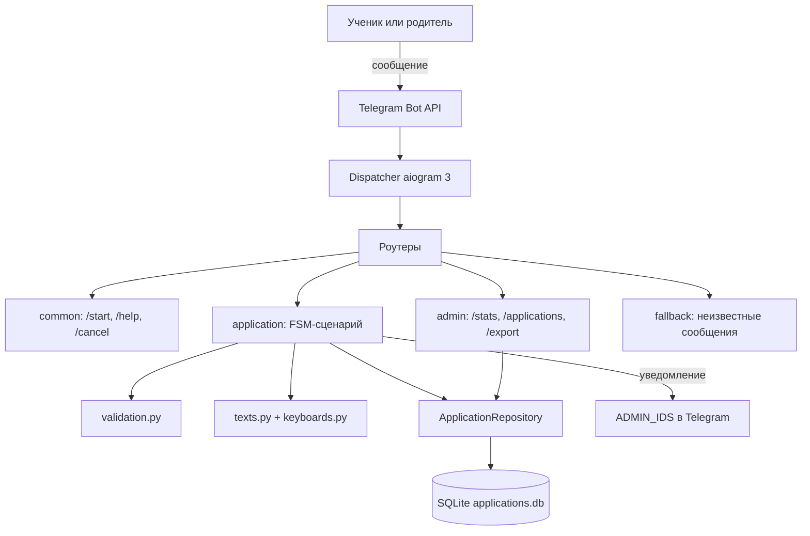
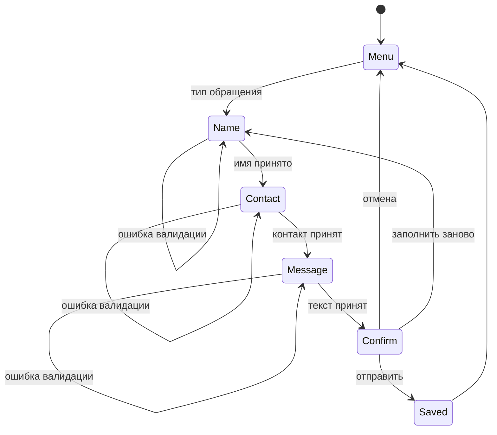

# Техническое описание проекта

**Проект:** Telegram-бот «КлассОнлайн»  
**Автор:** Зеленов Данил Сергеевич, группа 11/3-РПО-24/1  
**Место практики:** IT TOP college  
**Куратор:** Максим Николаевич  
**Период:** ноябрь 2026  
**Репозиторий:** <https://github.com/Duke13337/classonline-bot>

---

## 1. Аннотация

Онлайн-школа «КлассОнлайн» принимает обращения учеников и родителей в личных сообщениях Telegram. Сообщения смешиваются с перепиской, теряются и не дают общей картины: администратор не видит, сколько заявок пришло, какие темы популярны и кому уже ответили.

В рамках производственной практики разработан Telegram-бот, который становится единой точкой входа. Пользователь выбирает тип обращения, заполняет короткую форму, проверяет данные и отправляет заявку. Бот сохраняет её в SQLite, присваивает номер и уведомляет администратора. Администратор получает статистику, список последних заявок и выгрузку в CSV.

Проект реализован на Python 3.12 с использованием aiogram 3.31. Покрытие автотестами — 40 pytest-тестов.

---

## 2. Цель и задачи

**Цель:** собрать обращения в одном месте и убрать ручную обработку сообщений.

**Задачи:**

1. Разобрать процесс обработки обращений.
2. Спроектировать сценарий диалога.
3. Реализовать бота на Python и aiogram.
4. Спроектировать базу данных SQLite.
5. Добавить админ-команды и уведомления.
6. Протестировать и оформить документацию.

---

## 3. Требования и реализация

| Требование | Реализация |
|---|---|
| Приём заявок на занятия | тип «Запись на занятие» в главном меню |
| Вопросы по курсам | тип «Вопрос по курсу» с отдельной подсказкой |
| Прочие обращения | тип «Прочее» |
| Сохранение в SQLite | таблица `applications`, репозиторий `ApplicationRepository` |
| Токен в `.env` | `python-dotenv`, `Settings.from_env()` |
| Python + Telegram Bot API | Python 3.12, aiogram 3.31 |
| Доступ администратора через БД/консоль | команды `/stats`, `/applications`, `/export`; проверка `ADMIN_IDS` |
| Бонус: `/help` | справка по командам и сценарию |
| Бонус: счётчик обращений | `/stats`, блок «Всего» и разбивка по типам |
| Документация | README, техническое описание, паспорт, руководство, презентация |

---

## 4. Архитектура



### Слои приложения

| Слой | Файлы | Ответственность |
|---|---|---|
| Точка входа | `bot/main.py`, `bot/__main__.py`, `run.py` | настройки, подключение к БД, polling |
| Транспорт | aiogram `Dispatcher`, `Router` | приём обновлений Telegram |
| Сценарии | `bot/handlers/*.py` | диалоги и команды |
| Состояние | `bot/states.py` | FSM-состояния формы |
| Правила | `bot/validation.py` | проверка пользовательского ввода |
| Представление | `bot/texts.py`, `bot/keyboards.py` | тексты, форматирование, кнопки |
| Данные | `bot/database.py`, `bot/models.py` | схема, SQL, модели |
| Экспорт | `bot/services.py` | CSV с BOM |

Принципы:

- один сценарий — отдельный router;
- SQL выполняется только в репозитории;
- FSM хранит черновик заявки между шагами;
- настройки и секреты не хранятся в коде;
- весь пользовательский текст экранируется перед HTML-разметкой.

---

## 5. Модули

### `bot/config.py`

Читает `.env` через `python-dotenv`, возвращает иммутабельный `Settings`:

- `bot_token` — обязательный, иначе `RuntimeError` с подсказкой;
- `admin_ids` — множество целых чисел, парсер понимает `,` и `;`;
- `db_path` — абсолютный путь; относительный считается от корня проекта.

### `bot/database.py`

Содержит SQL-схему и класс `ApplicationRepository`:

| Метод | Назначение |
|---|---|
| `connect()` | создаёт файл и таблицы, включает `Row` |
| `close()` | закрывает соединение |
| `add(...)` | вставляет заявку, возвращает `Application` с ID |
| `count()` | общее число заявок |
| `recent(limit)` | последние заявки, ограничение 1…1000 |
| `stats()` | всего, новых, за 7 дней, по типам |

Одно соединение на процесс — достаточный компромисс для учебного проекта и последовательной обработки обновлений.

### `bot/models.py`

Две frozen-модели:

- `Application` — заявка (9 полей);
- `ApplicationStats` — сводка для `/stats`.

### `bot/validation.py`

- `normalize()` — убирает лишние пробелы и переводы строк;
- `validate_name()` — 2…100 символов, должна быть хотя бы одна буква;
- `validate_contact()` — телефон, e-mail или `@username`;
- `validate_message()` — 5…1000 символов;
- `ValidationError` — единый тип ошибки.

### `bot/texts.py`

- `TYPES` — три типа обращений: код, подпись, подсказка;
- `start_text()`, `summary_text()`, `success_text()`, `admin_notification()`;
- `stats_text()`, `recent_text()` — форматирование ответов;
- `human_datetime()` — `2026-11-14 12:40:05` → `14.11.2026 12:40`;
- `shorten()` — обрезка длинного текста в списке заявок;
- `html.escape()` для всех пользовательских значений.

### `bot/keyboards.py`

- `main_menu()` — 4 кнопки: три типа обращения и помощь;
- `cancel_menu()` — отмена;
- `confirm_menu()` — отправить, заполнить заново, отмена.

### `bot/handlers/`

| Файл | Обработчики |
|---|---|
| `common.py` | `/start`, `/help`, `/cancel`, `menu:help`, `form:cancel` |
| `application.py` | выбор типа, имя, контакт, текст, подтверждение, отправка, повтор |
| `admin.py` | `/stats`, `/applications [N]`, `/export` |
| `fallback.py` | неизвестное сообщение или устаревшая кнопка |

### `bot/services.py`

`applications_to_csv()` формирует CSV с заголовком из 9 колонок и BOM `\ufeff`, чтобы Excel корректно открыл кириллицу.

### `bot/main.py`

- настраивает логирование;
- загружает `Settings`;
- открывает репозиторий;
- создаёт `Bot` с `ParseMode.HTML`;
- собирает `Dispatcher`, кладёт `repo` и `settings` в workflow data;
- подключает роутеры в порядке: common → application → admin → fallback;
- удаляет webhook и запускает polling;
- в `finally` закрывает БД и сессию.

---

## 6. Пользовательский сценарий



### Состояния FSM

| Состояние | Что происходит | Данные в FSM |
|---|---|---|
| — | главное меню | — |
| `ApplicationForm.name` | бот просит имя и фамилию | `type_code`, `type_label` |
| `ApplicationForm.contact` | бот просит телефон, e-mail или `@username` | `full_name` |
| `ApplicationForm.message` | бот показывает подсказку по типу | `contact` |
| `ApplicationForm.confirm` | бот показывает сводку и кнопки | `message` |

### Детали поведения

1. `/start` очищает состояние и показывает меню.
2. Нажатие на тип обращения записывает код и подпись, переводит в `name`.
3. Ошибка валидации не меняет состояние — пользователь просто повторяет ввод.
4. Нетекстовое сообщение (фото, стикер) получает просьбу отправить текст.
5. На шаге подтверждения можно отправить заявку, заполнить заново или отменить.
6. При отправке проверяется наличие всех обязательных полей.
7. Заявка сохраняется, пользователь видит номер и дату, администратор получает уведомление.
8. `/cancel` и кнопка «Отмена» очищают состояние из любого шага.

### Защита от повторной отправки

После успешного сохранения состояние очищается, поэтому повторное нажатие кнопки подтверждения не создаёт дубль: callback относится к старому сообщению и обрабатывается fallback-роутером.

---

## 7. Модель данных

### Таблица `applications`

| Поле | Тип | Ограничение | Назначение |
|---|---|---|---|
| `id` | INTEGER | PK AUTOINCREMENT | номер заявки |
| `created_at` | TEXT | NOT NULL | дата и время создания |
| `user_id` | INTEGER | NOT NULL | Telegram ID пользователя |
| `username` | TEXT | — | `@username`, может быть пустым |
| `full_name` | TEXT | NOT NULL | имя и фамилия |
| `contact` | TEXT | NOT NULL | телефон, e-mail или `@username` |
| `type` | TEXT | NOT NULL | тип обращения |
| `message` | TEXT | NOT NULL | текст обращения |
| `status` | TEXT | NOT NULL DEFAULT `'new'` | статус заявки |

### Индексы

```sql
CREATE INDEX idx_applications_created_at ON applications (created_at DESC);
CREATE INDEX idx_applications_user_id    ON applications (user_id);
```

Первый ускоряет статистику за 7 дней и сортировку последних заявок, второй — выборку по пользователю.

### Статусы

| Статус | Значение |
|---|---|
| `new` | новая заявка, ещё не обработана |
| `processed` | заявка обработана администратором |

Смена статуса пока выполняется SQL-запросом через базу данных:

```sql
UPDATE applications SET status = 'processed' WHERE id = 14;
```

### Демонстрационные данные

`data/demo.db` содержит 14 заявок за последние 10 дней:

- всего — 14;
- новых — 9;
- за 7 дней — 10;
- по типам — 7 «Запись на занятие», 4 «Вопрос по курсу», 3 «Прочее».

Пересоздание:

```bash
python scripts/seed_demo.py
```

---

## 8. Валидация

| Поле | Правило | Пример корректного значения |
|---|---|---|
| Имя | 2…100 символов, есть буква | `Данил Зеленов` |
| Контакт | 5…100 символов, один из форматов ниже | `+7 900 123-45-67` |
| `@username` | 5…32 символа, латиница, цифры, `_` | `@class_online` |
| E-mail | текст `@` домен `.` зона 2+ буквы | `student@example.com` |
| Телефон | 10…20 символов, минимум 10 цифр | `8 (900) 123-45-67` |
| Сообщение | 5…1000 символов | `Хочу на математику, 8 класс` |

Все ошибки возвращаются пользователю понятным текстом и не создают заявку.

---

## 9. Администрирование

### Команды

| Команда | Поведение |
|---|---|
| `/stats` | всего, новых, за 7 дней, разбивка по типам |
| `/applications` | 5 последних заявок |
| `/applications 10` | 10 последних, максимум 20 |
| `/export` | CSV со всеми заявками (до 1000) |

### Проверка доступа

```python
def _is_admin(user_id: int, settings: Settings) -> bool:
    return user_id in settings.admin_ids
```

Если ID нет в `ADMIN_IDS`, бот отвечает: «🔒 Команда доступна только администратору».

### Уведомления

После сохранения заявки бот отправляет администраторам сообщение с номером, датой, типом, именем, контактом, Telegram-username и текстом. Ошибка отправки одному администратору логируется и не мешает остальным.

### CSV

Колонки: `id`, `created_at`, `user_id`, `username`, `full_name`, `contact`, `type`, `message`, `status`. Файл называется `applications_ГГГГ-ММ-ДД.csv`, кодировка UTF-8 с BOM, разделитель — запятая, перевод строки CRLF.

---

## 10. Конфигурация и безопасность

### Переменные окружения

| Переменная | Обязательна | По умолчанию |
|---|---|---|
| `BOT_TOKEN` | да | — |
| `ADMIN_IDS` | нет | пусто |
| `DB_PATH` | нет | `data/applications.db` |

### Меры безопасности

1. `.env` исключён из Git, в репозитории только `.env.example`.
2. Токен не попадает в логи и сообщения.
3. SQL-запросы параметризованы (`?`), конкатенации пользовательских данных нет.
4. HTML-режим включён, все пользовательские строки проходят `html.escape`.
5. Админ-команды проверяют ID из `ADMIN_IDS`.
6. Длинные сообщения ограничены 1000 символами.
7. Список заявок обрезает текст до 120 символов.

---

## 11. Тестирование

```bash
pip install -r requirements-dev.txt
pytest
```

Результат:

```text
40 passed
```

| Файл | Тестов | Покрытие |
|---|---:|---|
| `tests/test_validation.py` | 24 | корректные и некорректные имена, контакты, границы текста |
| `tests/test_texts.py` | 9 | даты, экранирование HTML, статистика, пустой список, обрезка |
| `tests/test_database.py` | 4 | вставка, чтение, переживание перезапуска, статистика, лимиты |
| `tests/test_services.py` | 3 | BOM, заголовок CSV, пустой username, пустая выгрузка |

Тестовая база создаётся в `tmp_path` и не затрагивает рабочую. Готовый шаблон CI лежит в `docs/ci-tests.yml`: он запускает pytest на Python 3.12 при push и pull request. Чтобы включить его, скопируйте файл в `.github/workflows/tests.yml`.

### Ручной чек-лист

- [x] `/start` показывает меню.
- [x] Каждый тип обращения открывает форму.
- [x] Неверный контакт возвращает ошибку.
- [x] Отмена на любом шаге очищает состояние.
- [x] Заявка сохраняется и получает номер.
- [x] Администратор получает уведомление.
- [x] `/stats` совпадает с содержимым базы.
- [x] `/export` открывается в Excel без настройки кодировки.
- [x] Обычный пользователь не получает доступ к админ-командам.

---

## 12. Запуск и эксплуатация

### Локальный запуск

```bash
python -m venv .venv
.venv\Scripts\activate          # Windows
pip install -r requirements.txt
copy .env.example .env          # Windows
python -m bot
```

Linux/macOS:

```bash
python3 -m venv .venv
source .venv/bin/activate
pip install -r requirements.txt
cp .env.example .env
python -m bot
```

### Требования к окружению

- Python 3.12+;
- доступ к `api.telegram.org`;
- права на запись в папку с базой;
- токен от `@BotFather`.

### Запуск на сервере (systemd)

Пример unit-файла:

```ini
[Unit]
Description=ClassOnline Telegram Bot
After=network-online.target

[Service]
Type=simple
WorkingDirectory=/opt/classonline-bot
ExecStart=/opt/classonline-bot/.venv/bin/python -m bot
Restart=always
RestartSec=5
User=classonline

[Install]
WantedBy=multi-user.target
```

### Резервное копирование

Достаточно копировать файл базы при остановленном боте:

```bash
cp data/applications.db backups/applications_$(date +%F).db
```

### Обновление

```bash
git pull
.venv/bin/pip install -r requirements.txt
systemctl restart classonline-bot
```

---

## 13. Демонстрационные материалы

| Файл | Назначение |
|---|---|
| `presentation/КлассОнлайн_презентация.pptx` | 13 слайдов для защиты |
| `presentation/screenshots/*.png` | экраны бота для слайдов и README |
| `presentation/demo/telegram_mock.html` | HTML-макет телефона, из которого сделаны экраны |
| `presentation/preview/СлайдN.PNG` | экспорт слайдов для проверки вёрстки |
| `docs/PRESENTATION.md` | речь по слайдам |

Сборка презентации:

```bash
pip install -r requirements-tools.txt
python tools/build_presentation.py
```

Сборка паспорта DOCX:

```bash
python tools/build_passport.py
```

---

## 14. Ограничения и направления развития

### Ограничения

- `MemoryStorage` хранит FSM в памяти: при перезапуске незавершённые черновики теряются.
- SQLite и одно соединение не рассчитаны на высокую конкурентность.
- Нет веб-панели и ролей: статусы меняются SQL-запросом.
- Уведомления отправляются только администраторам, обратной связи пользователю нет.

### Развитие

1. Веб-панель администратора с фильтрами и сменой статуса.
2. PostgreSQL и пул соединений.
3. Интеграция с CRM и расписанием онлайн-школы.
4. Напоминания о занятиях и повторные обращения.
5. Роли: администратор, методист, преподаватель.
6. Метрики и дашборд по типам обращений.

---

## 15. Итоги

В ходе практики:

- спроектирован и реализован Telegram-бот с тремя типами обращений;
- освоены aiogram 3, FSM, inline-клавиатуры и HTML-разметка;
- спроектирована база SQLite с индексами и репозиторием;
- добавлены админ-команды, уведомления и выгрузка CSV;
- написаны 40 автотестов;
- подготовлены README, техническое описание, паспорт, руководство и презентация;
- проект опубликован на GitHub.

Проект готов к демонстрации и может развиваться в сторону веб-панели и интеграции с CRM.
